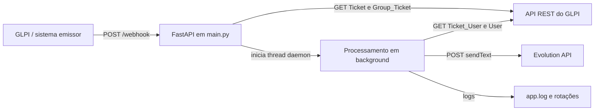

# Visão geral da arquitetura

## Fatos observados

A aplicação é um processo Python único. [main.py](../../../main.py) cria uma aplicação FastAPI, declara `POST /webhook` e inicia Uvicorn diretamente quando executado como script. O webhook consulta a API REST do GLPI com `requests`; os chamados elegíveis são processados por uma thread daemon e enviados à Evolution API.

O código não declara uma camada de persistência, fila externa, broker de eventos ou separação em pacotes. A deduplicação é feita em uma lista global do processo; detalhes em [[04 - Dados/Payload e estado|Payload e estado]].

## Responsabilidades e dependências

- **Entrada HTTP:** FastAPI interpreta JSON ou formulário e expõe o webhook.
- **Consulta ao GLPI:** funções no mesmo arquivo iniciam sessões e leem ticket, grupo e requerente.
- **Decisão:** o primeiro grupo técnico associado é comparado com `GRUPO_TI_ID`.
- **Envio:** uma thread monta a mensagem e usa o endpoint `sendText` da Evolution API.
- **Configuração e logs:** variáveis de ambiente são carregadas de `.env` ao lado do script/executável; logs são gravados em `app.log` no mesmo diretório.

As chamadas e seus dados estão em [[05 - Interfaces e Integrações/Índice|Interfaces e integrações]]. A sequência completa está em [[03 - Fluxos/Índice|Fluxos]].

## Inferência e limite

O código e o manifesto sugerem execução como serviço HTTP e possível empacotamento com PyInstaller. Não há evidência no repositório de um método de instalação, hospedagem, supervisão, proxy, container ou ambiente de produção; não se presume nenhum deles.

Referências: [`main.py`](../../../main.py), [`requirements.txt`](../../../requirements.txt).

← [[01 - Arquitetura/Índice|Índice de Arquitetura]]
