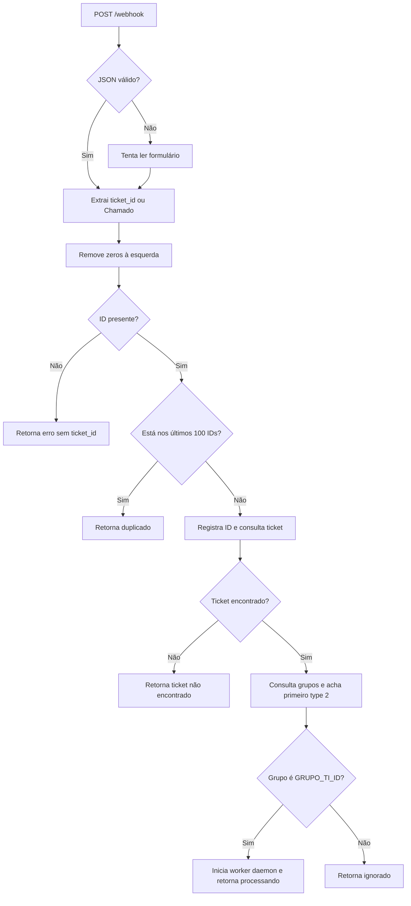

# Entrada e decisão

O fluxo é implementado por `handle_webhook` em [`main.py`](../../../main.py).

Comportamentos relevantes observados:

1. A entrada aceita JSON; se a leitura JSON falhar, tenta formulário. O código procura `ticket_id` ou `Chamado`.
2. O identificador é convertido em texto e passa por `lstrip("0")`. Se a string consistir somente em zeros, torna-se vazia e é tratada como ausente.
3. O ID é inserido na lista de deduplicação antes das consultas ao GLPI. A lista retém no máximo 100 itens no processo; erro posterior não remove o ID.
4. `buscar_grupo_ticket` fornece grupos; o handler usa o primeiro com `type == 2`. Se não encontrar, o grupo permanece `0`.
5. Se o grupo corresponder a `GRUPO_TI_ID`, inicia a thread e retorna `{"status": "ok", "processando": true}`; caso contrário, retorna `{"status": "ok", "ignorado": true}`.
6. Exceção não tratada no handler é registrada e retorna HTTP 500. As respostas de erro/duplicado não definem explicitamente outro status HTTP, portanto seguem o status de sucesso padrão do FastAPI.

Veja os formatos em [[04 - Dados/Payload e estado|Payload e estado]] e o endpoint em [[05 - Interfaces e Integrações/Webhook de entrada|Webhook de entrada]].

← [[03 - Fluxos/Índice|Índice de Fluxos]]
